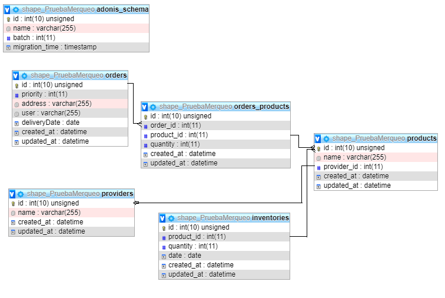

# 🛒 AdonisJS Cart & Retail Inventory Pricing Evaluator
> **E-Commerce Order Fulfillment, Inventory Balancing & Sales Analytics Microservice**

<div align="center">


</div>

---

## 📌 Context & Overview

This project implements a backend fulfillment and catalog evaluation engine designed for high-concurrency retail e-commerce environments using **AdonisJS (Node.js)**.

> [!NOTE]
> **Engineering Background:**  
> This solution was originally designed and built as the **technical evaluation for joining Merqueo** (one of Latin America's largest online grocery delivery tech companies). Demonstrating architectural clarity, database optimization, and scalable business logic in this assessment paved the way for my tenure at the company, where I subsequently advanced to **Technical Leader**, driving retail engineering across Colombia, Mexico, and Brazil.

---

## 📑 Technical Documentation & Artifacts

All accompanying architectural blueprints, database designs, and evaluation materials are available directly in this repository:

- 📄 **[Technical Write-Up & Architecture Paper (PDF)](./Desarrollo%20de%20la%20prueba.pdf)** — Complete technical documentation detailing architectural decisions, mathematical analysis, and implementation notes.
- 🗄️ **[Relational Database Schema (SQL)](./BaseDeDatos.sql)** — Complete DDL and seed scripts for MySQL / relational database.
- 📬 **[Postman API Suite (JSON)](./PostmanCollection.json)** — Ready-to-import Postman test collection with sample payloads.
- 📊 **[LaTeX Source Documents](./LaTeX/)** — Academic-grade LaTeX source files, charts, and diagrams.
- 📥 **[Test Inputs & Evaluation Datasets](./Enunciado%20e%20inputs/)** — Sample order, inventory, and supplier catalog JSON datasets.

---

## 🗄️ Database Entity-Relationship Model

The relational model optimizes order line-item traversal, inventory deduction, and supplier drop-ship assignment:

<div align="center">



</div>

---

## 🚀 Key Business Capabilities

The microservice automates critical e-commerce fulfillment and catalog decisions:

1. **📦 Multi-Channel Fulfillment Allocation:**
   - Evaluates incoming shopping cart items against real-time warehouse inventory.
   - Intelligently splits and routes fulfillable items to warehouse pickers (`/ProductsFromInventory`) vs direct drop-ship supplier fulfillment (`/ProductsFromProviders`).

2. **📊 Sales Velocity & SKU Analytics:**
   - Computes aggregated sales metrics to identify top-performing items (`/BestsSellers`) and lagging inventory (`/WorstsSellers`).
   - Enables dynamic inventory turnover and automated discounting strategies.

3. **🔄 Replenishment & Catalog Listing:**
   - Produces balanced restock schedules (`/NewInventory`) and client-facing product listings (`/Listings`) based on historical demand and supplier lead times.

4. **⚡ Data Ingestion Pipelines:**
   - High-throughput endpoints to populate inventory snapshots, client orders, and supplier catalogs (`/populate_inv`, `/populate_ord`, `/populate_prov`).

---

## 🛠️ Architecture & Tech Stack

- **Framework:** [AdonisJS](https://adonisjs.com/) (Node.js MVC with IoC container and lucid ORM)
- **Database:** Relational SQL with normalized schema ([`BaseDeDatos.sql`](./BaseDeDatos.sql))
- **Containerization:** Multi-stage Docker setup with `docker-compose` orchestration
- **API Specification:** Pre-configured Postman Collection included in repository root ([`PostmanCollection.json`](./PostmanCollection.json))

---

## 📋 API Endpoints

| Method | Endpoint | Description |
| :--- | :--- | :--- |
| `POST` | `/populate_inv` | Ingests initial warehouse inventory dataset |
| `POST` | `/populate_ord` | Ingests processed order records |
| `POST` | `/populate_prov` | Ingests supplier catalog pricing and availability |
| `GET` | `/ProductsFromInventory` | Returns order items fulfilled from internal stock |
| `GET` | `/ProductsFromProviders` | Returns order items routed to external suppliers |
| `GET` | `/BestsSellers` | Returns top-performing SKUs ordered by sales volume |
| `GET` | `/WorstsSellers` | Returns lowest-velocity SKUs for clearance evaluation |
| `GET` | `/Listings` | Generates active catalog listing |
| `GET` | `/NewInventory` | Calculates post-fulfillment replenishment requirements |

---

## ⚡ Quickstart

### Option A: Running with Docker (Recommended)

```bash
# 1. Build and start containers
docker-compose up --build -d

# 2. Verify service is healthy
curl http://localhost:8080/
```

### Option B: Local Development

```bash
# 1. Install dependencies
npm install

# 2. Setup environment variables
cp .env.example .env

# 3. Start development server
npm run serve:dev
# or using Adonis CLI: adonis serve --dev
```

The service will be live at `http://localhost:8080`.

---

## 🧪 Testing with Postman

Import the included [`PostmanCollection.json`](./PostmanCollection.json) into Postman or Insomnia to execute the end-to-end population and evaluation workflows out of the box.

---

## 👤 Author

**Kevin Andrey Herrera Silva**  
*Senior Backend Engineer & Software Architect*  
- LinkedIn: [linkedin.com/in/kevinandrey96](https://www.linkedin.com/in/kevinandrey96/)
- Location: Bogotá, Colombia
